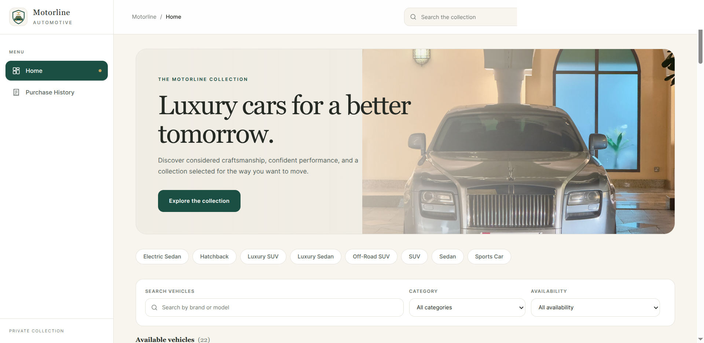
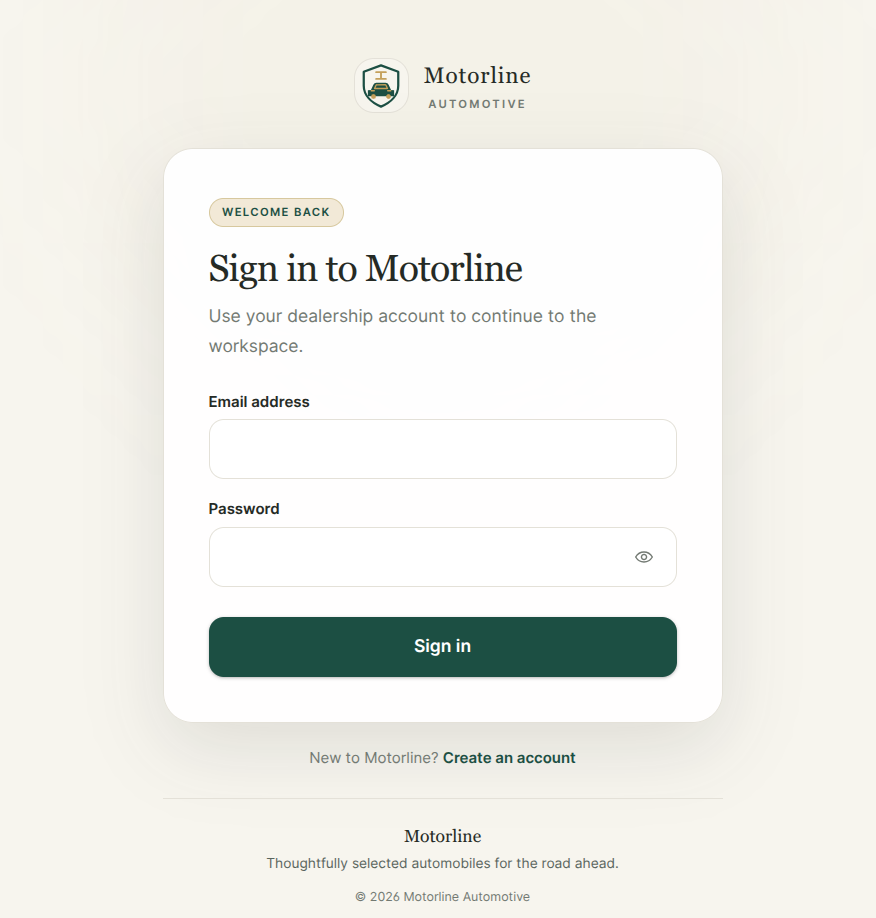
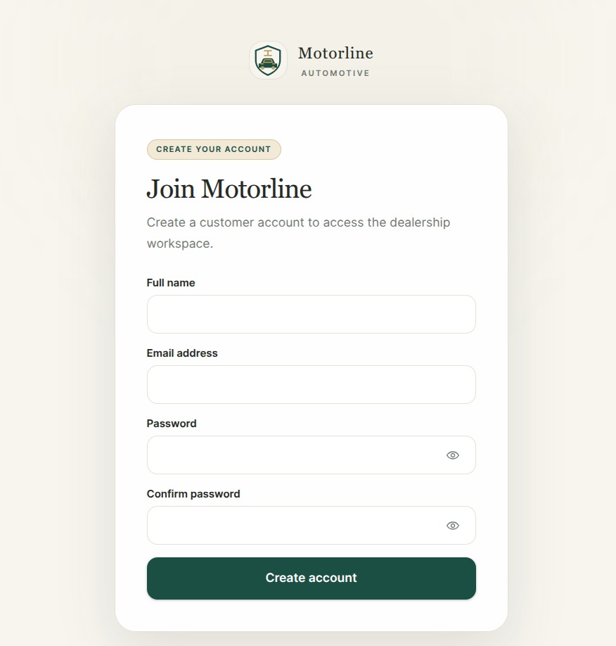
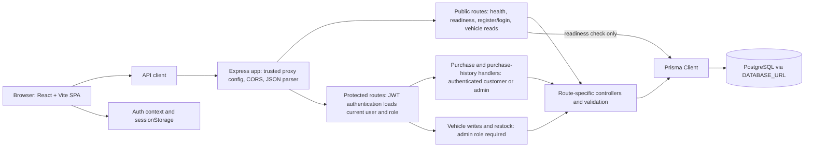

# Incubyte Car Dealership Inventory System

A full-stack dealership inventory application with customer purchasing, administrator inventory management, authenticated purchase history, and vehicle image support.

[](https://nodejs.org/)
[](https://react.dev/)
[](https://expressjs.com/)
[](https://www.prisma.io/)
[](https://www.postgresql.org/)

**Repository:** [rayarsingh100/Incubyte-car-dealership](https://github.com/rayarsingh100/Incubyte-car-dealership)<br>
**Live frontend:** [incubyte-car-dealership-2x0e.onrender.com](https://incubyte-car-dealership-2x0e.onrender.com)<br>
**Backend API:** [incubyte-car-dealership-api.onrender.com](https://incubyte-car-dealership-api.onrender.com)

The public frontend, backend health endpoint, vehicle-list endpoint, and frontend-to-backend CORS preflight were checked on 2026-10-25. The frontend bundle’s API base points to the backend URL above. Hosting dashboard settings, current plan, sleep behavior, and data durability are not independently verified by those public requests.

The application is branded **Motorline Automotive** in its customer and administrator UI; Incubyte Car Dealership is the assessment/project name.

## Screenshots

The screenshots below show the implemented Motorline UI. I removed visible account details and the unique order ID from the relevant captures; the vehicle-list capture is cropped to remove the viewer overlay. Inventory counts, prices, and the displayed purchase are capture-time data and may not match the current API. The purchase-history capture still displays its captured vehicle and amount, while the account identity and order ID are redacted.

### Customer experience

#### Home page



*Customer landing page and entry point to the API-backed vehicle collection.*

#### Vehicle listing


*Inventory cards show images, availability, prices, and purchase actions. The capture is cropped to the vehicle listing and contains no account header.*

#### Purchase history


*Customer purchase-history layout. The account header and unique order ID have been redacted; the captured row displays that payment details are unavailable.*

### Administrator experience

#### Inventory dashboard


*Inventory-derived metrics and stock summaries. The recent-activity panel is empty in this capture; dashboard values reflect the capture-time inventory.*

#### Vehicle management


*Administrator inventory management view. The account area has been redacted.*

### Authentication

| Sign in | Create an account |
| --- | --- |
| <br>*Sign in to an existing dealership account.* | <br>*Create a customer account.* |

## Contents

- [Overview](#overview)
- [Capabilities](#capabilities)
- [Technology](#technology)
- [Architecture](#architecture)
- [Repository structure](#repository-structure)
- [Run locally](#run-locally)
- [Environment variables](#environment-variables)
- [API reference](#api-reference)
- [Data model](#data-model)
- [Security](#security)
- [Testing and quality assurance](#testing-and-quality-assurance)
- [Deployment](#deployment)
- [Screenshots](#screenshots)
- [Concept workflow illustration](#concept-workflow-illustration)
- [AI-assisted development](#ai-assisted-development)
- [Limitations and next steps](#limitations-and-next-steps)
- [Contributing](#contributing)
- [License](#license)

## Overview

The application has two role-based experiences. Customers can browse the live inventory, complete a simulated demo payment, and view their own purchase history. Administrators can review inventory metrics, manage vehicles, and view customer orders. The React client talks to an Express JSON API; Prisma maps application records to PostgreSQL.

The administrator dashboard’s inventory totals and stock views are derived from API data. Its “Recent activity” panel currently has no activity feed and displays “No activity data is available.” Vehicle image links are optional; the interface shows a fallback icon when a URL is missing or cannot load.

## Capabilities

### Customer

- Register a customer account and sign in.
- Browse, search, and filter the API-backed vehicle inventory.
- Purchase a positive quantity when stock is available.
- See updated inventory after a successful purchase.
- View paginated purchase history belonging to the signed-in account.

### Administrator

- View inventory totals, availability, low-stock items, and estimated inventory value.
- Add, edit, delete, and restock vehicles.
- Set an optional HTTP or HTTPS vehicle image URL.
- Receive validation, authorization, stock-conflict, and API error feedback.

### Inventory and purchasing

- Paginated vehicle listing with search and field filters.
- Image URLs are optional and validated as HTTP/HTTPS URLs; URL syntax does not guarantee the remote resource is an image or remains available.
- Successful demo purchases record the stored unit price, demo payment result, and stock decrement in a Prisma transaction. Failed or cancelled simulations do not create an order or change stock.
- Insufficient stock returns a conflict response; conditional stock updates protect against overselling.

### Authentication and roles

- Public registration creates `USER` accounts. There is no public admin-registration option.
- The backend issues one-hour JWTs for login.
- The frontend keeps the session in tab-scoped `sessionStorage`, restoring it after a page refresh and clearing it on logout or an API `401` response.
- Admin-only UI is for usability; backend middleware enforces permissions.

## Technology

| Technology | Use in this project |
| --- | --- |
| React 19 | Customer and administrator interfaces, shared components, and auth context |
| Vite 8 | Frontend development server and static production build |
| Tailwind CSS 4 | Responsive styling and design utilities |
| Node.js 22 | JavaScript runtime for backend and frontend build tooling |
| Express 5 | REST endpoints, middleware, CORS, health checks, and error handling |
| PostgreSQL | Relational storage for users, vehicles, and purchases |
| Prisma 6.19.3 | Database schema, migrations, and typed database client |
| Jest + Supertest | Backend unit tests with a Prisma mock and HTTP-level assertions |
| Node.js built-in test runner | Focused frontend auth-session utility tests without another test dependency |

## Architecture



The frontend is a single-page app: section selection is held in React state, while the login/register view uses the URL hash; there is no client-side route library. The diagram separates public endpoints from routes that authenticate a bearer token. Admin-only vehicle mutations add a role check, while purchase endpoints accept any authenticated user and scope purchase history by role. `/api/health` does not query the database; `/api/ready` performs a read-only `SELECT 1`. CORS restricts browser access to the configured exact origin but is not the authorization boundary. The application connects to PostgreSQL using `DATABASE_URL`; Neon is the documented hosted deployment target, not a hardcoded application dependency.

## Repository structure

```text
.
├── README.md
├── backend/
│   ├── prisma/
│   │   ├── migrations/
│   │   └── schema.prisma
│   ├── scripts/                 # guarded test, deployment, and demo-admin tools
│   ├── src/
│   │   ├── config/              # JWT and trusted-proxy configuration
│   │   ├── controllers/
│   │   ├── lib/                 # Prisma, validation, and error helpers
│   │   ├── middleware/          # auth, CORS, and login rate limit
│   │   └── routes/
│   ├── tests/                   # Jest unit tests and guarded integration suite
│   ├── package.json
│   └── TEST_REPORT.md
└── frontend/
    ├── public/
    ├── src/
    │   ├── components/
    │   ├── context/
    │   ├── hooks/
    │   ├── layouts/
    │   ├── pages/
    │   ├── services/
    │   ├── styles/
    │   └── utils/
    ├── tests/
    └── package.json
```

## Run locally

Requirements: Node.js 22 (the frontend requires Node.js 20.19+ or 22.12+) and PostgreSQL. Run frontend and backend commands in separate terminals.

### 1. Configure and start the backend

```bash
cd backend
npm ci
cp .env.example .env
```

Edit `backend/.env` privately. Set `DATABASE_URL` to the intended local PostgreSQL database and generate a private `JWT_SECRET` with at least 32 random bytes. The server refuses to start when the JWT secret is missing or too short.

Then generate the Prisma client and apply migrations to the database you have explicitly verified:

```bash
npm run db:generate
npm run db:migrate
npm start
```

`npm run db:migrate` changes the configured database schema. Confirm the effective `DATABASE_URL` target before running it; do not point local setup or integration tests at a production or personal database unintentionally. The API listens on `PORT` (default `3000`) and binds to `0.0.0.0`.

### 2. Configure and start the frontend

In a second terminal:

```bash
cd frontend
npm ci
cp .env.example .env
npm run dev
```

The example uses `VITE_API_BASE_URL=/api`; Vite’s development-only proxy forwards `/api` to `http://127.0.0.1:3000`. For production, set the frontend’s build-time variable to the deployed backend URL ending in `/api`; the Vite proxy is not used in a production build.

### 3. Optional administrator setup

Public registration only creates `USER` accounts. For a separate demo database, the guarded `npm run provision:demo-admin` tool can create a new administrator after explicit target confirmation and hidden password entry. It will not promote an existing user. Read the complete safeguards in [backend/README.md](backend/README.md) before using it.

## Environment variables

Never commit `.env` files or put backend secrets in frontend build settings.

| Variable | Service | Purpose |
| --- | --- | --- |
| `DATABASE_URL` | Backend | PostgreSQL connection used by Prisma. |
| `JWT_SECRET` | Backend | JWT signing secret; at least 32 random bytes. |
| `PORT` | Backend | HTTP listener port; supplied by Render, defaults to `3000` locally. |
| `FRONTEND_ORIGIN` | Backend | Exact HTTPS frontend origin for cross-origin browser requests; no path or trailing slash. |
| `TRUST_PROXY_HOPS` | Backend | Set to `1` on the documented Render Web Service; this trusts the single Render proxy hop seen by Express. Leave unset for direct local development. Reassess if another proxy is added. |
| `LOGIN_RATE_LIMIT_WINDOW_MS` | Backend | Login limit window in milliseconds; defaults to 15 minutes. |
| `LOGIN_RATE_LIMIT_MAX` | Backend | Login attempts per window and client IP; defaults to 5. |
| `VITE_API_BASE_URL` | Frontend build | API base URL compiled into the browser bundle; `/api` for local Vite proxy, hosted HTTPS backend URL plus `/api` for Render. |
| `TEST_DATABASE_URL` | Test runner only | Explicit local PostgreSQL test target; must not be an application or production database. |
| `CONFIRM_TEST_DATABASE` | Test runner only | Exact database name confirmation required by the guarded integration runner. |
| `TEST_JWT_SECRET` | Integration tests only | Test-only signing secret; never use in a deployed service. |
| `DEMO_DATABASE_URL`, `CONFIRM_DEMO_HOST`, `CONFIRM_DEMO_DATABASE` | Admin provisioning only | Private target confirmation required by the one-time demo-admin CLI. |
| `SMOKE_API_BASE_URL` | Deployment smoke script | Backend HTTPS `/api` URL for non-mutating deployment checks. |
| `SMOKE_FRONTEND_ORIGIN` | Deployment smoke script | Optional exact frontend origin for CORS preflight checks. |
| `SMOKE_TEST_EMAIL`, `SMOKE_TEST_PASSWORD` | Deployment smoke script | Optional dedicated demo account for a single login and read-only history check. |

The deployment preflight also requires a verified `FRONTEND_ORIGIN` and `TRUST_PROXY_HOPS` for the separately hosted production frontend. Treat the checked-in `.env.example` files as templates, not production configuration; keep real values private.

## API reference

All endpoints are under `/api`, return JSON, and use errors shaped as `{ "error": { "code": "...", "message": "..." } }`. Authenticated requests use `Authorization: Bearer <JWT>`. Missing, invalid, or expired JWTs receive `401`; a regular user attempting an admin-only action receives `403`.

| Method and path | Access | Behavior |
| --- | --- | --- |
| `POST /api/auth/register` | Public | Accepts `name`, `email`, and `password`; creates a `USER`; returns `201 { user }`. Duplicate email returns `409`. |
| `POST /api/auth/login` | Public, rate limited | Accepts `email` and `password`; returns `200 { token, user }`; JWT expires after one hour. |
| `GET /api/vehicles` | Public | Returns `200` with paginated inventory; supports `page`, `limit`, `search`, exact `make`/`model`/`category`, `minPrice`, `maxPrice`, and `inStock`. |
| `GET /api/vehicles/search` | Public | Assignment-compatible alias for the filtered, paginated vehicle listing; accepts the same query parameters as `GET /api/vehicles`. |
| `GET /api/vehicles/:id` | Public | Returns `200 { vehicle }` or `404`. |
| `POST /api/vehicles` | Admin | Creates a vehicle; requires `make`, `model`, `category`, `price`, `quantity`; optional `imageUrl` may be an HTTP(S) URL or `null`; returns `201 { vehicle }`. |
| `PATCH /api/vehicles/:id` | Admin | Updates allowed vehicle fields and returns `200 { vehicle }`; `imageUrl: null` clears the image. Unknown fields are rejected. |
| `PUT /api/vehicles/:id` | Admin | Assignment-compatible alias for the same validated update operation as `PATCH`. |
| `DELETE /api/vehicles/:id` | Admin | Returns `200` after deletion; a vehicle with purchase history returns `409`. |
| `POST /api/vehicles/:id/restock` | Admin | Accepts a positive integer `quantity`, increments stock, and returns `200 { vehicle }`. |
| `POST /api/vehicles/:id/purchases` | Authenticated | Accepts `quantity` and optional demo outcome; only success records payment status and updates stock transactionally. |
| `POST /api/vehicles/:id/purchase` | Authenticated | Singular-path compatibility alias for the demo payment operation. |
| `GET /api/purchases` | Authenticated | Customers receive only their history; administrators receive all orders with safe buyer details. Both are paginated newest first. |
| `GET /api/health` | Public | Returns `200` liveness response; does not query the database. |
| `GET /api/ready` | Public | Read-only database readiness check (`SELECT 1`); returns `200` or sanitized `503`. |

Vehicle listing defaults to page 1 and 20 records per page (maximum 100). The API returns `{ vehicles, pagination: { page, limit, total, pages } }`. Purchase history uses the same pagination shape; each record includes its purchase-time unit price, quantity, creation time, computed total, payment status/method when available, and safe vehicle summary. Administrator responses additionally include the buyer's name and email.

Purchase requests accept `quantity` and optional `demoPaymentOutcome`: `success` (the default), `failure`, or `cancelled`. This is a deterministic demo simulation; no card details or real payments are processed. Failure and cancellation create no purchase and do not change stock. Success records `SUCCEEDED` / `DEMO_CARD` and decrements stock in the same database transaction.

## Data model

The Prisma schema defines three models:

| Model | Main fields | Relationships |
| --- | --- | --- |
| `User` | `id`, `name`, unique `email`, `passwordHash`, `role`, `createdAt` | One user can have many purchases. Role defaults to `USER`. |
| `Vehicle` | `id`, `make`, `model`, `category`, nullable `imageUrl`, `price`, `quantity`, timestamps | One vehicle can appear in many purchases. |
| `Purchase` | `id`, `userId`, `vehicleId`, `quantity`, purchase-time `unitPrice`, nullable `paymentStatus`/`paymentMethod`, `createdAt` | Belongs to one user and one vehicle; indexed by owner/date and vehicle/date. |

Relations use restrictive deletion: accounts and vehicles referenced by purchase history cannot be deleted. Demo payment fields are added by `backend/prisma/migrations/20261025120000_add_demo_payment_details/`; nullable fields preserve older rows without inventing payment information. Apply pending migrations only to the intended database through the documented release process.

## Security

- Passwords are hashed with bcrypt; password hashes are not returned from login or registration.
- JWTs expire after one hour. Protected API routes verify the JWT and load the account role from PostgreSQL; the role supplied by a browser is not authoritative.
- Registration cannot select an `ADMIN` role.
- Admin-only vehicle writes are protected by server-side authentication and role middleware.
- Request fields, quantities, prices, vehicle IDs, and image URL schemes are validated. Unknown vehicle fields are rejected.
- Stock decrement and purchase insertion use one database transaction and conditional updates.
- Login attempts are rate limited (default five per 15 minutes per process). Multi-instance hosting needs a shared limiter store for consistent global limits.
- CORS permits only the configured exact frontend origin and the required methods/headers. It does not replace authentication or authorization.
- The JWT is held in `sessionStorage`, which is accessible to JavaScript on the page; an HttpOnly-cookie design would reduce token exposure to XSS but would require a different backend/browser session contract. No refresh-token or server-side revocation endpoint is implemented.

These are implementation notes, not a claim of exhaustive security testing.

## Testing and quality assurance

Commands below should be run from the named package directory. The latest safe verification recorded for this project passed on 2026-10-25.

| Category | Command or check | Result and scope |
| --- | --- | --- |
| Backend unit/regression | `cd backend && npm run verify:safe` | Passed in this proxy-trust run: 13 Jest suites, 70 tests. Tests use a Prisma mock; this command excludes PostgreSQL integration. |
| Prisma | Included in `verify:safe`: `npm run db:validate` and `npm run db:generate` | Passed: schema validation and Prisma Client generation. No database connection is made. |
| Syntax and frontend build | Included in `verify:safe` | Passed: listed backend `node --check` files and Vite production build. |
| Frontend tests | `cd frontend && npm test` | Passed in this audit: 3 Node test cases covering restore, invalid stored data, and logout clearing. |
| Git whitespace | Included in `verify:safe`; also `git diff --check` | Passed in the recorded safe run. |
| PostgreSQL integration | `cd backend && npm run test:integration` | Not verified against a dedicated disposable database. `TEST_REPORT.md` records a historical 1-suite/8-test run against a local development database before the stricter current guard; it is not evidence that the current guarded suite passes against an isolated target. |
| Live read-only smoke checks | `GET /api/health`, `GET /api/vehicles?page=1&limit=100`, `OPTIONS /api/vehicles` with the frontend origin | Checked 2026-10-25: frontend and API health returned `200`, vehicle list returned `200` with 12 vehicles, and CORS preflight returned `204` for the configured frontend origin. No inventory writes were sent. |
| Image delivery spot check | Headless Chrome requests for the 12 image URLs returned by the public API | Checked 2026-10-25: 12 image loads completed. This checks image delivery, not an authenticated end-to-end UI workflow. |
| Auth API smoke | Earlier user-reported local checks | Registration `201`, login `200`, and a regular user’s admin-only vehicle write `403`; not independently rerun as part of the latest safe verification. |

A Red–Green cycle is documented for the bcrypt 72-byte UTF-8 login boundary: a regression test first demonstrated the failing behavior, then the validation fix passed. This is evidence of that specific test-first change, not of project-wide TDD. Tests establish only the behaviors they exercise; they do not demonstrate that all defects or security issues are absent. See [backend/TEST_REPORT.md](backend/TEST_REPORT.md) for dated historical records and detailed limitations.

## Deployment

The observed deployment uses a Render static frontend, a Render Node.js API, and Neon PostgreSQL. The public URLs above and current frontend-to-backend routing were checked by read-only HTTP requests. The Render dashboard settings, current plan, proxy-hop count, backups, and data-retention guarantees are not independently visible from this repository; verify them in the host dashboards before treating this demo as durable production service.

The repository’s documented Render settings are:

| Service | Root | Build | Start / publish | Important configuration |
| --- | --- | --- | --- | --- |
| Backend Web Service | `backend` | `npm ci && npm run db:generate` | `npm start`; health check `/api/health` | `NODE_VERSION=22.22.0`, `DATABASE_URL`, private `JWT_SECRET`, `FRONTEND_ORIGIN=https://incubyte-car-dealership-2x0e.onrender.com`, and `TRUST_PROXY_HOPS=1`; Render supplies `PORT`. |
| Frontend Static Site | `frontend` | `npm ci && npm run build` | Publish `dist` | `NODE_VERSION=22.22.0`; build-time `VITE_API_BASE_URL=https://incubyte-car-dealership-api.onrender.com/api`. This value is public and compiled into the browser bundle. |

Apply Prisma migrations only as a deliberate release step after verifying the Neon project, branch, and database target. The owner reports that the image URL migration is applied and Prisma reported the schema up to date; this README preparation did not connect to Neon or run migration commands. Never use an application database for destructive integration tests. Follow the target-confirmation and migration instructions in [backend/README.md](backend/README.md).

The deployment preflight and smoke scripts are available as `npm run preflight:deploy` and `npm run smoke:deploy` from `backend/`. The smoke script is designed for health/readiness and read-only routes, optional CORS preflight, and optional single-account login; it does not register users or mutate inventory.

## Concept workflow illustration

> **Concept illustration only — not a representation of implemented screens or data.** The legacy image below depicts a vehicle-details page, a cart, dashboard purchase/revenue/user metrics, and a `Cart Items` database model; those features are not implemented. Its administrator purchase table is illustrative, not a screenshot of the actual admin page (admin purchase history is implemented). In the application, customers browse vehicle cards and purchase through a demo-payment modal; the admin dashboard reports inventory metrics; and the database has only `User`, `Vehicle`, and `Purchase` models. The sample account and administrator order rows in the illustration have been redacted. Use the source-based architecture diagram above and the captions on the app captures as implementation evidence.


## My AI Usage

OpenAI Codex is identified in the available repository history by `Co-authored-by: Codex <codex@openai.com>` trailers and assisted with implementation, tests, and documentation. This audit also used Codex for source inspection, test-first route compatibility changes, documentation updates, and verification. The repository does not establish the owner's personal reflection on time saved, learning, or manual review; those statements are intentionally not inferred.

The available [AI-use note](PROMPTS.md) explains the missing raw records; it is not a complete transcript or public conversation link. Complete prompt and response logs were not available in the project workspace, so no transcript or public conversation link is claimed here. The repository history and recorded evidence support specific test-first changes, including the bcrypt boundary fix and the route compatibility additions in this audit; they do not establish that the entire project followed TDD. The owner should complete the reflection prompt in `PROMPTS.md` and attach authentic records if the assessment requires them. For future AI-assisted commits, use the real identity accepted by the assessment; existing history uses `Co-authored-by: Codex <codex@openai.com>`. No commit was created or retroactively changed for this audit.

## Limitations and next steps

- Run the current database integration suite against a separately verified, dedicated disposable PostgreSQL database; do not reuse an application database.
- Add repeatable browser-to-backend tests for customer and administrator workflows without relying on real customer data.
- Consider an HttpOnly cookie-based session and CSRF protection if the threat model warrants the additional backend/CORS work.
- Replace the in-memory login limiter with a shared store before horizontally scaling the API.
- Confirm Render proxy trust, Neon backups/restore, connection limits, and retention policy before using the demo for durable business data.
- Vehicle images are externally hosted URLs; image availability and content are not guaranteed by this application.
- Add genuine screenshots and, if required by the assessment, preserve complete raw AI logs without editing them.

## Contributing

For a change, open a focused branch or pull request and describe the behavior affected. Run `npm run verify:safe` from `backend/` and `npm test -- --test-reporter=spec` from `frontend/`. Do not commit environment files or secrets. Only run database integration tests against a dedicated, explicitly confirmed test database.

## License

No root `LICENSE` file is present, so this repository does not specify a project license. The `ISC` metadata in the backend package manifest is package metadata and is not a substitute for a repository license file.

---

Built as an Incubyte assessment project to demonstrate a full-stack inventory and purchasing workflow, with explicit attention to role checks, stock consistency, and honest reporting of test coverage and limitations.
